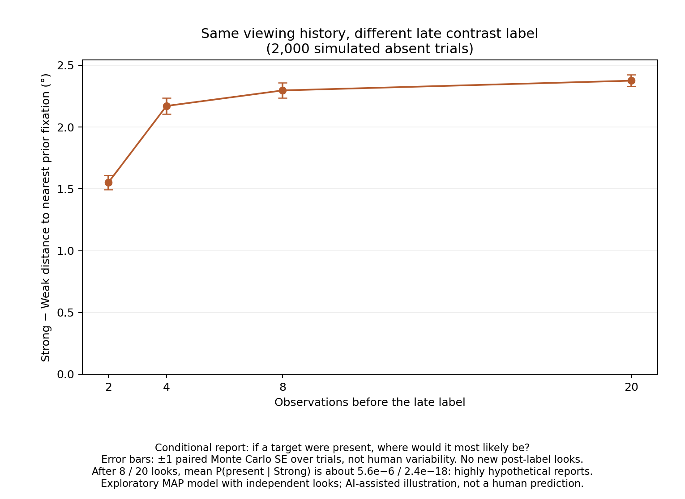

# Late contrast information and spatial reports

**Question:** Same viewing history, different contrast information. Does the reported location change?

## Code

- 19 locations: center, six at 4°, twelve at 8°; assumed layout.
- Weak visibility: d′(e) = 3 × 4.68 / (e + 4.68). Strong = twice Weak. Falloff and 4.68° from [Zhang & Geisler (2025)](https://doi.org/10.1167/jov.25.4.5); peak and ratio illustrative.
- Each look: responses at all 19 locations; Gaussian, SD 1; mean 0 off target, d′ at the target.
- Independent noise across looks, as in the dynamic-noise formulation of [Najemnik & Geisler (2005)](https://doi.org/10.1038/nature03390).
- 2,000 absent trials; seed 52001. Observer prior: 50% absent; uniform location and equally likely contrasts if present.
- Search under Either: central start, then MAP target-location selection. Stays allowed; no stopping threshold.
- Re-read the same history under Weak, Either and Strong after 2, 4, 8 and 20 looks. No additional observations.

### Result

**Report:** “If a target were present, where would it most likely be?” Highest-posterior location.

**Measure:** Distance from that report to the nearest gaze position in the completed history. Compare Strong minus Weak within each trial.



| Looks | Mean Strong − Weak distance ± paired MC SE |
|---:|---:|
| 2 | 1.551° ± 0.057° |
| 4 | 2.171° ± 0.065° |
| 8 | 2.297° ± 0.062° |
| 20 | 2.375° ± 0.047° |

Modest responses count more against a strong target at well-inspected locations. The label can therefore change the location ranking.

### Limits

- One illustrative setting. Independent looks approximate a static display; MAP is a heuristic. Looks are not seconds.
- Mean P(present | Strong): 5.6 × 10⁻⁶ after 8 looks; 2.4 × 10⁻¹⁸ after 20. These conditional reports are highly hypothetical.
- Nearest-gaze distance is a proxy for inspection. Strategic guessing could also produce a shift. No unique human mechanism or novelty claim.
- Error bars: simulation precision, not human variability. No human effect-size or power estimate.

- Conditional spatial reports only; detection and false-alarm effects are not simulated.

### Run

Tested with Python 3.12.14; dependencies pinned.

```bash
python -m venv .venv
source .venv/bin/activate
python -m pip install -r requirements.txt
python simulate.py
```

- `simulate.py`: model, run, four checks, figure.
- `results/`: summary, figure, per-trial records.
- [notes.md](notes.md): equations, code notes, proposal context.

## Related work

- [de Haan et al. (1996)](https://doi.org/10.1068/p250591): contrast pre/postcues; abstract reviewed.
- [Kim & Chong (2024)](https://doi.org/10.1016/j.cognition.2024.105938): spatial guesses in poorly resolved regions; abstract/introduction reviewed, full methods unverified.
- [Schipper & Mazor (2025, preprint)](https://matanmazor.github.io/files/papers/schipper2025confidence.pdf): counterfactual visibility; relevant methods/results reviewed.

Code and literature review: AI-assisted.
